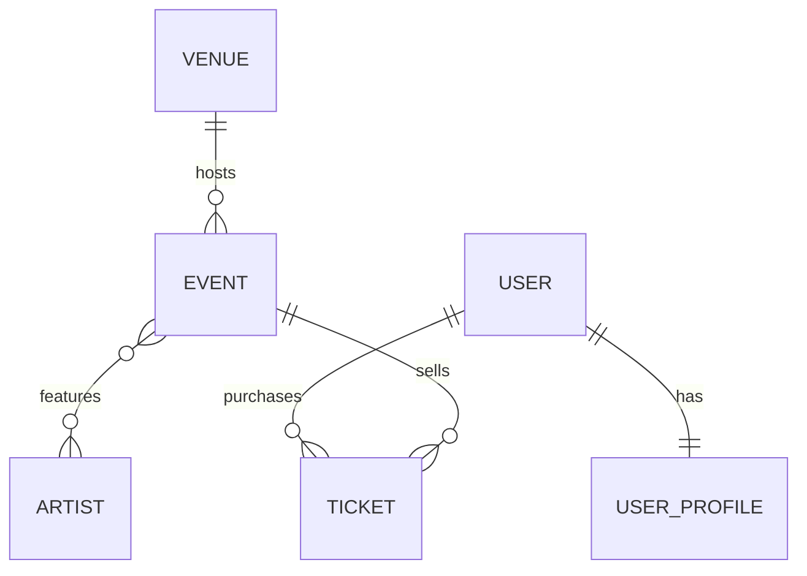

# PulsePass

Núcleo de **PulsePass**, una plataforma de eventos, artistas y entradas. Tiene cuatro capas y una fase de pruebas end-to-end:

- **Persistencia:** modelo relacional versionado con Flyway, entidades JPA, repositories Spring Data y pruebas de integración contra PostgreSQL real con Testcontainers.
- **Servicios:** reglas de negocio, transacciones, DTOs, mapeo con MapStruct, excepciones de dominio y pruebas unitarias con Mockito.
- **Controladores:** API REST con Spring MVC, validación de requests con Bean Validation, manejo centralizado de errores y pruebas de contrato HTTP con MockMvc.
- **Seguridad:** autenticación stateless con JWT Bearer, contraseñas con BCrypt, roles `USER`, `STAFF` y `ADMIN`, y control de propiedad de los recursos.
- **Pruebas E2E:** colección de Postman para recorrer a mano las 22 rutas contra la aplicación real y PostgreSQL, con bitácora de resultados.

La fuente de verdad de los requisitos es `PRD_PulsePass.md` (persistencia), `PRD_PulsePass_Capa_Servicios` (servicios) `PRD_PulsePass_Capa_Controladores_v2` (controladores) `PRD_PulsePass_Capa_Seguridad_Spring_Security_JJWT` (seguridad) y `PRD_PulsePass_Pruebas_E2E_Postman_Manual` (pruebas E2E). Los IDs que aparecen abajo (`FR-*`, `BR-*`, `AC-*`, `QT-*`, `SRV-*`, `CTRL-*`, `TEST-*`, `SEC-*`, `T-SEC-*`) son los de esos documentos.

## Tecnologías

| Componente | Detalle |
|---|---|
| Lenguaje | Java 21 |
| Framework | Spring Boot 4.1.1 |
| Persistencia | Spring Data JPA / Hibernate |
| Base de datos | PostgreSQL |
| Migraciones | Flyway (único responsable del esquema) |
| Mapeo Entity → DTO | MapStruct |
| API REST | Spring MVC, Bean Validation |
| Seguridad | Spring Security, JWT con JJWT 0.13 (HS256), BCrypt |
| Pruebas | JUnit 5, AssertJ, Mockito, MockMvc, Spring Security Test, Testcontainers |
| Pruebas E2E | Postman (Collection v2.1, ejecución manual) |
| Build | Maven (`./mvnw`) |

## Requisitos previos

- JDK 21.
- Docker en ejecución para las pruebas de persistencia. Levantan su propio PostgreSQL con Testcontainers, así que **no hace falta instalar PostgreSQL** para probar. Las pruebas unitarias de servicios y las de controladores no necesitan Docker.

## Estructura

```
src/main/java/com/pulsepass/
├── controller/    controllers REST (Venue, Event, Artist, User, Ticket)
├── domain/        entidades JPA y enums
├── repository/    interfaces JpaRepository con las consultas
├── dto/
│   ├── request/   records de entrada (CreateEventRequest, RegisterUserRequest, PurchaseTicketRequest)
│   └── response/  records de salida (VenueResponse, EventResponse, ..., ErrorResponse)
├── mapper/        mappers MapStruct Entity → DTO
├── exception/     excepciones de dominio y GlobalExceptionHandler
└── service/       interfaces de servicio
    └── impl/      implementaciones @Service y estrategia de precios
src/main/resources/
├── application.yml
└── db/migration/  V1__create_schema, V2__insert_initial_artists, V3__add_streaming_url_to_event
src/test/java/com/pulsepass/                pruebas de integración de persistencia
src/test/java/com/pulsepass/service/impl/   pruebas unitarias de servicios
src/test/java/com/pulsepass/controller/     pruebas de contrato HTTP con MockMvc
```

## Modelo de dominio



| Relación | Mapeo JPA | Tabla / columna |
|---|---|---|
| Venue 1:N Event | `@ManyToOne(fetch = LAZY)` en `Event.venue` | `events.venue_id` (FK, NOT NULL) |
| Event N:M Artist | `@ManyToMany` + `@JoinTable` en `Event.artists` (lado propietario) | `event_artists` con PK compuesta `(event_id, artist_id)` |
| User 1:1 UserProfile | `@OneToOne` en `UserProfile.user` | `user_profiles.user_id` (FK + UNIQUE) |
| User 1:N Ticket | `@ManyToOne(fetch = LAZY)` en `Ticket.user` | `tickets.user_id` (FK, NOT NULL) |
| Event 1:N Ticket | `@ManyToOne(fetch = LAZY)` en `Ticket.event` | `tickets.event_id` (FK, NOT NULL) |

`Ticket` es una entidad y no un `@ManyToMany` entre `User` y `Event` porque tiene datos propios: `ticketCode`, `type`, `price`, `status` y `purchaseDate` (BR-006).

Enums (`EventCategory`, `EventStatus`, `TicketType`, `TicketStatus`): se guardan con `@Enumerated(EnumType.STRING)`, nunca por ordinal (BR-008).

## Esquema y migraciones

| Migración | Qué hace |
|---|---|
| `V1__create_schema.sql` | Crea `venues`, `events`, `artists`, `event_artists`, `users`, `user_profiles` y `tickets`, con PK, FK, UNIQUE, CHECK e índices. |
| `V2__insert_initial_artists.sql` | Inserta el catálogo inicial: Solar Beat, Neon Waves, Caribbean Sound, Ocean Drive y Digital Pulse. |
| `V3__add_streaming_url_to_event.sql` | Agrega `events.streaming_url VARCHAR(500)` nullable, sin modificar V1. |

Una migración ya aplicada **no se edita**: cualquier cambio estructural nuevo va en una migración nueva (`V4__...`). Hibernate corre con `ddl-auto=validate`: solo comprueba que las entidades coincidan con el esquema, nunca lo crea ni lo modifica.

### Integridad reforzada en PostgreSQL

| Regla | Constraint |
|---|---|
| `venues.code`, `events.event_code`, `artists.stage_name`, `users.username`, `users.email`, `tickets.ticket_code` únicos | `UNIQUE` |
| Capacidad del venue mayor que cero | `CHECK (capacity > 0)` |
| Precio del ticket mayor o igual a cero | `CHECK (price >= 0)` |
| Categoría y estado del evento, tipo y estado del ticket dentro del catálogo | `CHECK (... IN (...))` |
| Un solo perfil por usuario | `UNIQUE (user_id)` en `user_profiles` |
| Sin pares evento-artista repetidos | PK compuesta en `event_artists` |
| Todo evento tiene venue; todo ticket tiene usuario y evento | FK `NOT NULL` |
| Precios con precisión decimal (BR-007, NFR-008) | `DECIMAL(10,2)` en BD, `BigDecimal` en Java |

## Consultas

Los métodos simples usan Query Methods; las consultas con agregación, `DISTINCT` o varias asociaciones usan JPQL (NFR-007). No hay SQL nativo en los repositories.

| Necesidad | Método | Mecanismo |
|---|---|---|
| Venue por código (FR-VEN-001) | `VenueRepository.findByCode` | Query Method |
| Evento por `eventCode` (AC-002) | `EventRepository.findByEventCode` | Query Method + `@EntityGraph(venue)` |
| Eventos de un venue por código (FR-VEN-004) | `EventRepository.findByVenue_CodeOrderByEventDateAsc` | Query Method navegando la relación |
| Eventos publicados por fecha (FR-EVT-005) | `EventRepository.findByStatusOrderByEventDateAsc` | Query Method |
| Eventos por artista (FR-SRC-001, FR-ART-004) | `EventRepository.findByArtistStageName` | JPQL con `JOIN` + `DISTINCT` |
| Eventos por ciudad y artista (FR-SRC-002) | `EventRepository.findByVenueCityAndArtistStageName` | JPQL con varias asociaciones |
| Eventos recomendados (FR-SRC-003) | `EventRepository.findRecommendedEvents` | JPQL con filtros, `DISTINCT`, `LOWER` y `ORDER BY` |
| Artista por nombre artístico | `ArtistRepository.findByStageName` | Query Method |
| Usuario por email sin distinguir mayúsculas | `UserRepository.findByEmailIgnoreCase` | Query Method |
| Usuario por username | `UserRepository.findByUsername` | Query Method |
| Perfil por usuario | `UserProfileRepository.findByUser_Id` | Query Method |
| Tickets de un usuario por email y estado (FR-TKT-006) | `TicketRepository.findByUser_EmailIgnoreCase[AndStatus]` | Query Method navegando la relación |
| Tickets PAID de un evento (FR-TKT-007) | `TicketRepository.findByEvent_EventCodeAndStatus` | Query Method |
| Conteo de tickets PAID (FR-TKT-008) | `TicketRepository.countPaidTicketsByEventCode` | JPQL con `COUNT` |
| Tickets de eventos futuros (FR-SRC-004) | `TicketRepository.findTicketsOfFutureEvents` | JPQL con `ORDER BY` |

Consultas agregadas para la capa de servicios (todas Query Methods):

| Necesidad | Método |
|---|---|
| Venues activos por nombre (BR-VENUE-002) | `VenueRepository.findByActiveTrueOrderByNameAsc` |
| ¿Existe el código de evento? (BR-EVENT-001) | `EventRepository.existsByEventCode` |
| Artista por nombre artístico sin distinguir mayúsculas | `ArtistRepository.findByStageNameIgnoreCase` |
| Artistas activos por nombre (BR-ARTIST-002) | `ArtistRepository.findByActiveTrueOrderByStageNameAsc` |
| ¿Existe el username o el email? (BR-USER-001, 002) | `UserRepository.existsByUsername`, `existsByEmailIgnoreCase` |
| Ticket por código | `TicketRepository.findByTicketCode` |
| Tickets de un usuario, del más reciente al más antiguo | `TicketRepository.findByUser_EmailIgnoreCaseOrderByPurchaseDateDesc` |

**Por qué FR-TKT-007 es un Query Method:** es un filtro por dos atributos (uno navegando `event`) sin joins explícitos ni agregaciones; el nombre del método ya expresa la intención y no hace falta JPQL.

## Decisiones de diseño

- **Relaciones `LAZY` y `open-in-view=false`.** Un `Event` cargado fuera de una transacción trae su `venue` como proxy sin inicializar. Por eso `findByEventCode` usa `@EntityGraph(attributePaths = "venue")`: el evento y su venue llegan en una sola consulta (AC-002).
- **Identificadores `IDENTITY`.** Coinciden con `BIGSERIAL` en PostgreSQL. Como el `INSERT` se ejecuta al hacer `save`, una violación de UNIQUE aparece de inmediato.
- **La capa de persistencia no calcula `SOLD_OUT`** (BR-010): el repository persiste el estado tal como llega. Quien decide el cambio es `TicketService` al completar la capacidad (BR-TICKET-008).
- **API REST sin autenticación**: los endpoints son públicos; seguridad, paginación y OpenAPI quedan fuera del alcance de los tres PRD.

## Capa de servicios

```
Service Interface → Service Implementation → Repository / Mapper → Entity → PostgreSQL
```

Cada servicio tiene interfaz e implementación (SRV-003), recibe sus dependencias `final` por constructor (SRV-002) y solo retorna DTOs (SRV-001). Las reglas de negocio viven en el servicio; los repositories solo acceden a datos (SRV-005).

| Servicio | Operaciones | Reglas |
|---|---|---|
| `VenueService` | `findByCode`, `findActiveVenues` | BR-VENUE-001, 002 |
| `ArtistService` | `findById`, `findByStageName`, `findActiveArtists` | BR-ARTIST-001, 002 |
| `EventService` | `create`, `findByCode`, `findPublishedEvents`, `publish`, `addArtist`, `findByArtist` | BR-EVENT-001 a 011 |
| `UserService` | `register`, `findByEmail`, `findByUsername` | BR-USER-001 a 005 |
| `TicketService` | `purchase`, `findByCode`, `findByUserEmail`, `findPaidTicketsByEvent`, `cancel`, `markAsUsed` | BR-TICKET-001 a 014 |

### Excepciones

| Excepción | Cuándo | Ejemplo |
|---|---|---|
| `ResourceNotFoundException` | El recurso no existe | `Event not found: CMF-2026` |
| `DuplicateResourceException` | Conflicto de unicidad | `Username already exists: andrea` |
| `BusinessRuleException` | El recurso existe pero la operación no es válida | `User does not meet minimum age.` |

Las tres extienden `RuntimeException`, así que cualquier fallo dentro de un método `@Transactional` hace rollback.

### Transacciones

Cada implementación está anotada con `@Transactional(readOnly = true)` a nivel de clase, y las escrituras (`create`, `publish`, `addArtist`, `register`, `purchase`, `cancel`, `markAsUsed`) lo sobrescriben con `@Transactional` (SRV-004). El mapeo a DTO ocurre dentro de la transacción, por lo que las relaciones `LAZY` se pueden leer aunque `open-in-view` esté en `false`.

La compra es atómica: validar usuario, evento, edad y capacidad, calcular el precio, crear el ticket y actualizar `SOLD_OUT` ocurren en una sola transacción.

### Decisiones de la capa de servicios

- **Precio.** El cliente no envía el precio. `TicketPricingStrategy` lo calcula como `precio base × multiplicador del tipo`, con precio base `100000.00`: `GENERAL` ×1.00, `STUDENT` ×0.80, `VIP` ×2.00 y `BACKSTAGE` ×3.00. La implementación (`DefaultTicketPricingStrategy`) está aislada y tiene sus propias pruebas.
- **Edad mínima.** Se calcula con `UserProfile.birthDate` y se evalúa en la fecha del evento, no en la fecha de compra. Si el evento exige edad y el usuario no tiene fecha de nacimiento, la compra se rechaza.
- **Capacidad.** Se compra solo si `paidTickets < venue.capacity`. Cuando la compra deja `paidTickets == venue.capacity`, el evento pasa a `SOLD_OUT` en la misma transacción.
- **`UserResponse` incluye el perfil.** `User` no tiene referencia a `UserProfile`, así que `UserMapper` recibe ambas entidades.
- **Artista repetido en un evento** lanza `DuplicateResourceException`. Además, no se asocian artistas inactivos (`BusinessRuleException`).
- **Consultas por usuario, evento o artista inexistente** lanzan `ResourceNotFoundException` en vez de retornar una lista vacía.
- **Cancelar un ticket no devuelve el evento de `SOLD_OUT` a `PUBLISHED`**: el PRD no define esa transición.
- **Concurrencia.** Contar tickets, validar capacidad y guardar no protege contra dos compras simultáneas del último cupo. Queda fuera del alcance (PRD, sección 53).

## API REST

Los controllers solo traducen HTTP a llamadas de Service y el resultado a HTTP: no tienen reglas de negocio, no usan repositories y solo retornan DTOs (CTRL-001 a 004). Cada método de los cinco Services tiene un endpoint (20 operaciones), más dos de autenticación. La columna **Acceso** es la regla de `SecurityConfig`; la propiedad de cada recurso se valida además en los Services (ver [Seguridad](#seguridad)).

| Método | Endpoint | Service | Éxito | Acceso |
|---|---|---|---|---|
| POST | `/api/auth/login` | `AuthService.login` | 200 | Público |
| GET | `/api/auth/me` | `AuthService.currentUser` | 200 | Autenticado |
| GET | `/api/venues/{code}` | `VenueService.findByCode` | 200 | Público |
| GET | `/api/venues/active` | `VenueService.findActiveVenues` | 200 | Público |
| POST | `/api/events` | `EventService.create` | 201 | ADMIN |
| GET | `/api/events/{eventCode}` | `EventService.findByCode` | 200 | Público (borradores: STAFF o ADMIN) |
| GET | `/api/events/published` | `EventService.findPublishedEvents` | 200 | Público |
| PATCH | `/api/events/{eventCode}/publish` | `EventService.publish` | 200 | ADMIN |
| POST | `/api/events/{eventCode}/artists/{artistId}` | `EventService.addArtist` | 200 | ADMIN |
| GET | `/api/events/by-artist?stageName=...` | `EventService.findByArtist` | 200 | Público (borradores: STAFF o ADMIN) |
| GET | `/api/artists/{id}` | `ArtistService.findById` | 200 | Público |
| GET | `/api/artists/by-stage-name?stageName=...` | `ArtistService.findByStageName` | 200 | Público |
| GET | `/api/artists/active` | `ArtistService.findActiveArtists` | 200 | Público |
| POST | `/api/users` | `AuthService.register` | 201 | Público |
| GET | `/api/users/by-email?email=...` | `UserService.findByEmail` | 200 | Propietario o ADMIN |
| GET | `/api/users/by-username?username=...` | `UserService.findByUsername` | 200 | Propietario o ADMIN |
| POST | `/api/tickets` | `TicketService.purchase` | 201 | USER, solo con su propio email |
| GET | `/api/tickets/{ticketCode}` | `TicketService.findByCode` | 200 | Propietario, STAFF o ADMIN |
| GET | `/api/tickets/by-user?email=...` | `TicketService.findByUserEmail` | 200 | Propietario o ADMIN |
| GET | `/api/events/{eventCode}/tickets/paid` | `TicketService.findPaidTicketsByEvent` | 200 | STAFF o ADMIN |
| PATCH | `/api/tickets/{ticketCode}/cancel` | `TicketService.cancel` | 200 | Propietario o ADMIN |
| PATCH | `/api/tickets/{ticketCode}/use` | `TicketService.markAsUsed` | 200 | STAFF o ADMIN |

`GET /api/events/{eventCode}/tickets/paid` vive en `EventController` porque su ruta cuelga de un evento; por dentro llama a `TicketService`.

### Validación de requests

`CreateEventRequest`, `RegisterUserRequest` y `PurchaseTicketRequest` llevan anotaciones de Bean Validation (`@NotBlank`, `@NotNull`, `@Email`, `@Min`, `@Size`) y los endpoints los reciben con `@Valid @RequestBody`. Un request inválido se rechaza con 400 antes de llegar al Service. Las reglas de negocio (usuario activo, edad mínima, capacidad, transiciones de estado) siguen en los Services y llegan al cliente como 409.

Las longitudes máximas coinciden con las columnas de la base de datos, para que un texto demasiado largo se rechace con 400 y no con un error de PostgreSQL.

### Contrato de errores

Todos los errores salen de `GlobalExceptionHandler` (`@RestControllerAdvice`) como `ResponseEntity<ErrorResponse>`:

```json
{
  "timestamp": "2026-10-04T20:00:00",
  "status": 400,
  "error": "Bad Request",
  "message": "Validation failed",
  "details": {
    "eventCode": "Event code is required"
  }
}
```

| Causa | Código | `message` |
|---|---|---|
| Bean Validation (`MethodArgumentNotValidException`) | 400 | `Validation failed`, con cada campo en `details` |
| JSON mal formado o con un valor que no se puede convertir | 400 | `Malformed JSON request` |
| Falta un `@RequestParam` obligatorio | 400 | `Missing required parameter: ...` |
| Un parámetro de ruta con tipo incorrecto (`/api/artists/abc`) | 400 | `Invalid value for parameter: ...` |
| `ResourceNotFoundException` o una ruta que no existe | 404 | El mensaje del Service |
| Método HTTP no soportado en una ruta existente | 405 | `Method not allowed: ...` |
| `DuplicateResourceException` o `BusinessRuleException` | 409 | El mensaje del Service |
| Sin token, o con un token inválido, vencido o de un usuario inactivo | 401 | `Authentication required`, `Invalid or expired token` o `Invalid credentials` en el login |
| Rol insuficiente o recurso de otro usuario | 403 | `No tiene permisos para realizar esta operación` |
| Cualquier otra excepción | 500 | `Unexpected error`, sin detalles internos (NFR-CTRL-007); el detalle queda en el log |

## Seguridad

La API es stateless: no hay sesión ni cookies. Cada request protegido lleva `Authorization: Bearer <token>`. El token es un JWT firmado con HS256 que dura 15 minutos y solo guarda el id del usuario (`sub`), el emisor (`iss`), las fechas (`iat`, `exp`) y un id único (`jti`). Los roles y el estado del usuario se leen de la base de datos en cada request, así que desactivar un usuario le quita el acceso aunque su token siga vigente.

### Configuración

La clave del JWT nunca se escribe en el repositorio. Se lee de variables de entorno; `.env.example` muestra cuáles son:

| Variable | Obligatoria | Por defecto |
|---|---|---|
| `PULSEPASS_JWT_SECRET_BASE64` | Sí. Base64 de al menos 32 bytes aleatorios | — |
| `PULSEPASS_JWT_ISSUER` | No | `pulsepass-api` |
| `PULSEPASS_JWT_ACCESS_TOKEN_TTL` | No | `PT15M` |

Sin la clave, o con una de menos de 32 bytes, la aplicación no arranca. Para generar una:

```bash
openssl rand -base64 32
```

Las pruebas usan una clave ficticia propia, definida en `src/test/resources/config/application.properties`; no sirve para ningún otro entorno.

### Registro, login y usuario actual

`POST /api/users` crea el usuario, su perfil y su credencial en una sola transacción. La contraseña (12 a 72 caracteres) se guarda solo como hash BCrypt en `user_credentials` y el rol siempre es `USER`: el cliente no puede elegirlo. El registro no entrega un token; después hay que iniciar sesión.

```bash
curl -X POST http://localhost:8080/api/auth/login \
  -H "Content-Type: application/json" \
  -d '{"identifier":"andrea","password":"UnaFraseSeguraLarga2026!"}'
```

```json
{ "accessToken": "eyJhbGciOiJIUzI1NiJ9...", "tokenType": "Bearer", "expiresIn": 900 }
```

`identifier` acepta el username o el email. Si el usuario no existe, la contraseña es incorrecta o la cuenta está inactiva, la respuesta es la misma: 401 `Invalid credentials`.

```bash
curl http://localhost:8080/api/auth/me -H "Authorization: Bearer <token>"
```

### Roles y propiedad

| Rol | Puede |
|---|---|
| `USER` | Comprar tickets para sí mismo y consultar o cancelar sus tickets y sus datos |
| `STAFF` | Consultar cualquier ticket, ver los tickets pagados de un evento, marcar tickets como usados y ver eventos en borrador |
| `ADMIN` | Lo mismo que `STAFF`, más crear y publicar eventos, asociar artistas, consultar cualquier usuario y cancelar cualquier ticket. No compra tickets: comprar es solo de `USER` |

`SecurityConfig` decide quién puede llamar cada endpoint según su rol. La propiedad se valida en los Services con `AuthorizationService`, comparando el id del dueño en la base de datos con el id del usuario autenticado, nunca con un id o un email enviado por el cliente. Pedir el recurso de otro usuario responde 403. Un evento en borrador responde 404 a un anónimo o a un `USER`, para no revelar que existe.

Los usuarios creados antes de esta fase no tienen credencial, así que no pueden iniciar sesión hasta que se les cree una.

### Crear un STAFF o un ADMIN

El registro público solo crea `USER`. Para dar otro rol, primero se registra la cuenta y luego se agrega el rol en la base de datos:

```sql
INSERT INTO user_roles (user_id, role)
SELECT id, 'ADMIN' FROM users WHERE username = 'admin';
```

Cambiar `'ADMIN'` por `'STAFF'` para un empleado de taquilla. El cambio aplica desde el siguiente request, porque los roles se leen de la base de datos.

### Limitaciones conocidas

- No hay refresh token ni logout: el token vale hasta que vence (15 minutos).
- `STAFF` tiene acceso a todos los eventos; no hay asignación de staff por evento.
- No hay límite de intentos de login.

## Pruebas

```bash
./mvnw clean test
```

Requiere Docker en ejecución. Testcontainers levanta PostgreSQL, Flyway construye el esquema desde cero y luego se ejecutan repositories y consultas.

Para ejecutar solo las pruebas unitarias de servicios, sin Docker:

```bash
./mvnw test "-Dtest=*ServiceImplTest,DefaultTicketPricingStrategyTest"
```

Para ejecutar solo las pruebas de controladores, también sin Docker:

```bash
./mvnw test "-Dtest=*ControllerTest"
```

Para ejecutar solo las pruebas de seguridad que no necesitan Docker:

```bash
./mvnw test "-Dtest=Jwt*Test,CustomUserDetailsServiceTest,Auth*Test"
```

Las clases terminan en `Test` (no en `IT`) para que `mvn test` las ejecute con Surefire. Las pruebas que escriben datos corren en una transacción que se revierte al terminar, y las que verifican lo que quedó en la base llaman a `flushAndClear()` antes de consultar, para que los datos se lean de PostgreSQL y no de la caché de Hibernate.

| Clase | Cubre |
|---|---|
| `FlywayMigrationTest` | QT-001, QT-002, V2 con los cinco artistas, V1 a V4 aplicadas |
| `VenuePersistenceTest` | FR-VEN-001 a 004, AC-001, QT-003, QT-009 |
| `EventRepositoryTest` | FR-EVT-001 a 006, AC-002, AC-006 |
| `EventArtistTest` | FR-ART-001 a 003, AC-003, QT-005 |
| `EventSearchTest` | FR-SRC-001 a 003, FR-ART-004, AC-007, QT-008 |
| `UserProfileTest` | FR-USR-001 a 004, AC-004, QT-004 |
| `TicketRepositoryTest` | FR-TKT-001 a 008, FR-SRC-004, AC-005, AC-008, QT-006 a QT-008 |
| `UserCredentialPersistenceTest` | Migración V4: credencial con el id del usuario, roles y constraints |
| `SecurityIntegrationTest` | T-SEC-001, 004, 005, 008, 015: registro, login, `/me` y propiedad con la base real |
| `PulsepassApplicationTests` | El contexto de Spring arranca |

Pruebas unitarias de la capa de servicios. Usan `@ExtendWith(MockitoExtension.class)` con repositories y mappers simulados; no levantan Spring ni PostgreSQL (NFR-001) y siguen ARRANGE / ACT / ASSERT.

| Clase | Cubre |
|---|---|
| `VenueServiceImplTest` | FR-SVC-001, 002, BR-VENUE-001, 002 |
| `ArtistServiceImplTest` | FR-SVC-009, BR-ARTIST-001, 002 |
| `EventServiceImplTest` | TEST-EVENT-001 a 008, BR-EVENT-001 a 011, FR-SVC-005, 007, 008 |
| `UserServiceImplTest` | TEST-USER-001 a 004, FR-SVC-011, 012 |
| `TicketServiceImplTest` | TEST-TICKET-001 a 012, BR-TICKET-005, 012, FR-SVC-014 a 016, propiedad de tickets |
| `DefaultTicketPricingStrategyTest` | BR-TICKET-009 y la estrategia de precios |
| `AuthServiceImplTest` | Registro con hash y rol USER, login, credenciales inválidas |
| `AuthorizationServiceImplTest` | Propietario, roles y acceso sin identidad |
| `JwtServiceTest` | Claims del token, vencimiento, firma, emisor, algoritmo y clave |
| `JwtAuthenticationFilterTest` | Bearer válido, inválido, repetido o de un usuario inactivo |
| `CustomUserDetailsServiceTest` | Carga por username, email o id; usuario sin credencial |

Pruebas de contrato HTTP. Usan `@WebMvcTest` (solo levanta la capa web), `MockMvc` y los Services reemplazados con `@MockitoBean`; no levantan PostgreSQL. Importan `SecurityConfig` para probar las mismas reglas de acceso que en producción, y la identidad llega con `.with(user(...))` de Spring Security Test. Cada prueba valida el status, el `Content-Type`, los campos del JSON con `jsonPath` y la llamada al Service con `verify`. En los requests inválidos, `verify(..., never())` confirma que el Service nunca se invocó.

| Clase | Cubre |
|---|---|
| `VenueControllerTest` | TEST-CTRL-VEN-001 a 003, error 500 sin detalles internos |
| `ArtistControllerTest` | TEST-CTRL-ART-001 a 004, ID no numérico → 400 |
| `EventControllerTest` | TEST-CTRL-EVT-001 a 009, TEST-CTRL-TKT-007, T-SEC-002, 003 |
| `UserControllerTest` | TEST-CTRL-USR-001 a 005, parámetro faltante → 400, T-SEC-015 |
| `AuthControllerTest` | T-SEC-005, 006, 019, login inválido → 400, `/me` |
| `TicketControllerTest` | TEST-CTRL-TKT-001 a 006 y 008 a 011, JSON mal formado → 400, T-SEC-007 a 013 y 016 |

Algunas pruebas usan SQL nativo únicamente para **verificar** constraints de PostgreSQL (por ejemplo, forzar un estado fuera del catálogo o un par evento-artista repetido). Los requisitos de consulta se resuelven solo con Query Methods y JPQL.

## Pruebas E2E manuales

Además de las pruebas automáticas, `tests/e2e/` tiene una colección de Postman para probar la aplicación real de punta a punta: registro, login, roles, propiedad, publicación de eventos y ciclo de vida de los tickets, contra una base exclusiva `pulsepass_e2e`. Se ejecuta a mano, request por request, sin scripts.

| Archivo | Contenido |
|---|---|
| `tests/e2e/README.md` | Preparación, cómo ejecutar cada request, copiar tokens y registrar resultados |
| `tests/e2e/postman/` | Colección (127 requests en 10 carpetas) y ambiente sin valores sensibles |
| `tests/e2e/fixtures/` | `seed-e2e.sql` y los comandos para recrear la base |
| `tests/e2e/checklist-e2e-manual.md` | Orden de ejecución |
| `tests/e2e/registro-ejecucion-manual.md` | Bitácora con esperado, observado y PASS / FAIL / BLOCKED |

## Ejecutar la aplicación

Al arrancar, Flyway aplica las migraciones, Hibernate valida el esquema y la API queda disponible en `http://localhost:8080`.

Con Testcontainers, sin instalar nada más (usa la clave de prueba):

```bash
./mvnw spring-boot:test-run
```

Contra un PostgreSQL propio:

```bash
docker compose up -d
export PULSEPASS_JWT_SECRET_BASE64=$(openssl rand -base64 32)
./mvnw spring-boot:run
```

La conexión se configura con las variables `DB_URL`, `DB_USER` y `DB_PASSWORD`. Sus valores por defecto son `jdbc:postgresql://localhost:5432/pulsepass`, `postgres` y `postgres`.

Para probar la API con la base recién creada (V2 ya trae los artistas):

```bash
curl http://localhost:8080/api/artists/active
curl "http://localhost:8080/api/artists/by-stage-name?stageName=Solar%20Beat"
```

No hay endpoints para crear venues, así que para crear eventos primero hay que insertar un venue en la base de datos.
