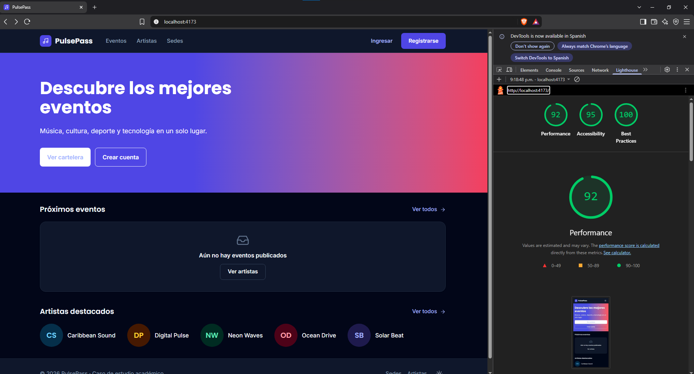

# PulsePass Web

Frontend de PulsePass: cartelera de eventos, artistas y sedes, compra de entradas, validación de ingreso para el personal y administración de eventos. Consume la API REST de este mismo repositorio (`../src/main/java`), protegida con JWT.

## Tecnologías

| Para qué           | Qué usamos                                                                                        |
| ------------------ | ------------------------------------------------------------------------------------------------- |
| Base               | React 19, TypeScript 6 (strict), Vite 8                                                           |
| Rutas              | React Router 8 (modo data: `createBrowserRouter`, rutas `lazy`)                                   |
| Datos del servidor | TanStack Query 5                                                                                  |
| Formularios        | React Hook Form + Zod (`@hookform/resolvers`)                                                     |
| Estilos            | Tailwind CSS v4 (`@theme` en `src/index.css`), `clsx`                                             |
| Pruebas            | Vitest, Testing Library, `user-event`, MSW (mock de la API)                                       |
| Calidad            | ESLint 10 (flat config, `typescript-eslint`, reglas de hooks), Prettier con el plugin de Tailwind |

> Usamos ESLint en vez de oxlint (lo que trae ahora `create-vite`) y fijamos TypeScript `~6.0` porque `typescript-eslint` todavía no soporta TypeScript 7.

## Requisitos

- Node.js 22.22 o superior y npm.
- El backend corriendo en `http://localhost:8080` (ver el README de la raíz).

## Cómo correrlo

```bash
cd pulsepass-web
npm install
cp .env.example .env      # en PowerShell: Copy-Item .env.example .env
npm run dev               # http://localhost:5173
```

En desarrollo, Vite redirige `/api` al backend (`vite.config.ts`), así que no hace falta configurar CORS en Spring.

| Variable            | Valor por defecto | Para qué                                                           |
| ------------------- | ----------------- | ------------------------------------------------------------------ |
| `VITE_API_BASE_URL` | `/api`            | Prefijo de todas las peticiones. Con el proxy de Vite se deja así. |

## Comandos

| Comando              | Qué hace                                 |
| -------------------- | ---------------------------------------- |
| `npm run dev`        | Servidor de desarrollo con recarga       |
| `npm run build`      | Revisa tipos (`tsc -b`) y genera `dist/` |
| `npm run lint`       | ESLint sobre todo el proyecto            |
| `npm run format`     | Prettier sobre `src/`                    |
| `npm test`           | Todas las pruebas una vez                |
| `npm run test:watch` | Pruebas en modo observador               |
| `npm run preview`    | Sirve `dist/` para revisarlo             |

## Datos para la demo

Las migraciones solo cargan artistas. Para mostrar todo el flujo:

1. Arranca el backend contra la base `pulsepass` y abre el frontend.
2. En `/registro` crea tres cuentas: una normal (ej. `andrea`), `demo_staff` y `demo_admin`.
3. Carga las sedes y sube los roles:

   ```bash
   docker exec -i pulsepass-db psql -U postgres -d pulsepass < pulsepass-web/demo/seed-demo.sql
   ```

4. Entra como `demo_admin`, crea un evento en `/admin/eventos/nuevo`, asócialo con artistas y publícalo.
5. Entra como `andrea` y compra una entrada; luego como `demo_staff` valida el ingreso con el código del ticket.

## Rutas

| Ruta                                                                  | Quién        | Página                                     |
| --------------------------------------------------------------------- | ------------ | ------------------------------------------ |
| `/`                                                                   | todos        | Inicio con eventos destacados              |
| `/eventos`, `/eventos/:eventCode`                                     | todos        | Cartelera con filtros y detalle con compra |
| `/artistas`, `/artistas/:id`                                          | todos        | Artistas activos y sus eventos             |
| `/sedes`, `/sedes/:code`                                              | todos        | Sedes activas                              |
| `/login`, `/registro`                                                 | sin sesión   | Ingreso y registro                         |
| `/cuenta`                                                             | con sesión   | Perfil (y búsqueda de usuarios para ADMIN) |
| `/mis-tickets`, `/mis-tickets/:ticketCode`                            | USER         | Tickets propios, cancelación               |
| `/compra/confirmacion/:ticketCode`                                    | USER         | Resultado de la compra                     |
| `/staff/validacion`                                                   | STAFF, ADMIN | Validación de ingreso                      |
| `/staff/eventos/:eventCode/tickets`                                   | STAFF, ADMIN | Tickets pagados de un evento               |
| `/admin/eventos`, `/admin/eventos/nuevo`, `/admin/eventos/:eventCode` | ADMIN        | Crear, publicar y asociar artistas         |

## Diseño

Las vistas siguen los 32 diseños de la sección 9 del PRD, guardados en [`docs/diseno/`](docs/diseno) con el nombre que les da el PRD (`Main.png`, `Catalogo.png`, `DetalleEvento.png`…). Incluyen las variantes móviles de 390 px y las de modo oscuro.

- Colores, tipografía y tamaños del sistema visual (9.1) están en el bloque `@theme` de `src/index.css`.
- La API no entrega imágenes: cada evento usa el panel de color e ícono de su categoría (DES-02) y cada artista un círculo con sus iniciales.
- El modo oscuro se cambia con el botón del pie de página y se recuerda en el navegador.

## Estructura

```
src/
├── componentes/       piezas de UI reutilizables (Boton, Campo, Modal, Tabla, Badge...)
├── funcionalidades/   una carpeta por recurso: tipos (Zod), api, hooks de Query y componentes propios
│   ├── auth/  eventos/  artistas/  sedes/  usuarios/  tickets/  admin/
├── layouts/           Layout, Navbar y las rutas protegidas por sesión y por rol
├── lib/               cliente HTTP, token, formatos, errores, QueryClient
├── pages/             una página por ruta (cargadas con lazy)
├── test/              setup de Vitest, mocks de MSW y helper de render
├── router.tsx
└── main.tsx
```

## Decisiones

- **Token:** el JWT vive en memoria y se copia en `sessionStorage` para sobrevivir a un F5 dentro de la misma pestaña; se borra al salir o cuando expira. Al arrancar se valida con `GET /api/auth/me`.
- **401:** si una petición con token responde 401, la sesión se cierra y se manda a `/login` con el aviso de sesión expirada.
- **Validaciones:** Zod solo revisa la forma (campos vacíos, longitudes). Las reglas de negocio (edad mínima, aforo, estados) las decide el backend y su mensaje se muestra tal cual.
- **Errores 400 con `details`:** se pintan en el campo correspondiente del formulario.

## Brechas de la API (GAP del PRD)

| GAP | Brecha                                    | Qué hace el frontend                                                                  |
| --- | ----------------------------------------- | ------------------------------------------------------------------------------------- |
| 01  | No hay `GET /api/events`                  | `/admin/eventos` recuerda los creados en la pestaña y abre cualquiera por código      |
| 02  | Los borradores solo los ven STAFF/ADMIN   | 403/404 en el detalle se muestra como "Evento no disponible"                          |
| 03  | No hay tickets por id de usuario          | "Mis tickets" usa el email de `/api/auth/me`                                          |
| 04  | El evento no informa entradas disponibles | Se muestra el aforo de la sede (`/api/venues/{code}`) y la compra puede responder 409 |
| 05  | El backend no tiene CORS                  | Proxy de Vite en desarrollo                                                           |
| 06  | El precio lo fija el backend              | La compra no envía precio; se muestra el de `TicketResponse`                          |
| 07  | El registro no entrega token              | Registro → login con aviso                                                            |
| 08  | No hay refresh token                      | Al expirar (401 o el temporizador local) se cierra la sesión y se va a `/login`       |

Además, `TicketResponse` no trae el nombre del titular, así que donde el diseño muestra el nombre (detalle de ticket, validación, tickets pagados) se muestra su correo.

## Pruebas

72 pruebas en 9 archivos, con la API simulada por MSW (`src/test/mocks/handlers.ts`). Los nombres siguen los IDs del PRD (`TEST-FE-AUTH-*`, `TEST-FE-EVT-*`, `TEST-FE-TKT-*`, `TEST-FE-STF-*`, `TEST-FE-ADM-*`, `TEST-FE-GEN-*`). Cualquier petición que no tenga mock hace fallar la prueba.

## Calidad (Lighthouse, móvil)

| Página       | Performance | Accessibility | Best Practices |
| ------------ | ----------- | ------------- | -------------- |
| `/` (Inicio) | 92          | 95            | 100            |

Medido el 2026-11-21 con `npm run build` y `npm run preview`, en modo oscuro, desde las herramientas de desarrollo del navegador (Lighthouse, modo _Navigation_, dispositivo _Mobile_). El PRD pide Performance ≥ 80 en Inicio (NFR-FE-003) y ningún error crítico de accesibilidad (QT-FE-011).



Después de la medición se corrigió el contraste del botón "Ver cartelera" en modo oscuro (el texto quedaba claro sobre fondo blanco).

## Integrantes

| Nombre            |
| ----------------- | 
| Alexander Fajardo |
| Carlos Crespo     |

## Problemas que tuvimos

- La clave JWT generada con `openssl` en la terminal de IntelliJ traía un `\r` al final y la API no arrancaba (`not valid Base64`). Se arregló con `| tr -d '\r\n'`.
- Los tokens duran 15 minutos y vencían a mitad del recorrido E2E en Postman; hubo que repetir los logins y anotarlo en la bitácora.
- La copia de la colección de Postman que teníamos importada era vieja (solo carpetas 00 a 05) y hubo que reimportarla desde el repositorio.
- `create-vite` trae ahora TypeScript 7 y oxlint, pero `typescript-eslint` todavía no soporta TypeScript 7; se dejó TypeScript 6 con ESLint.